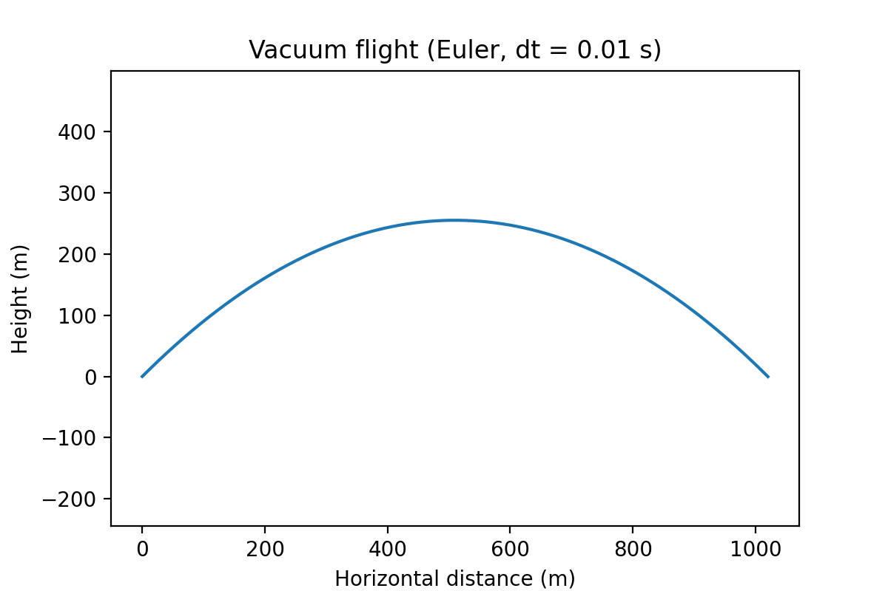
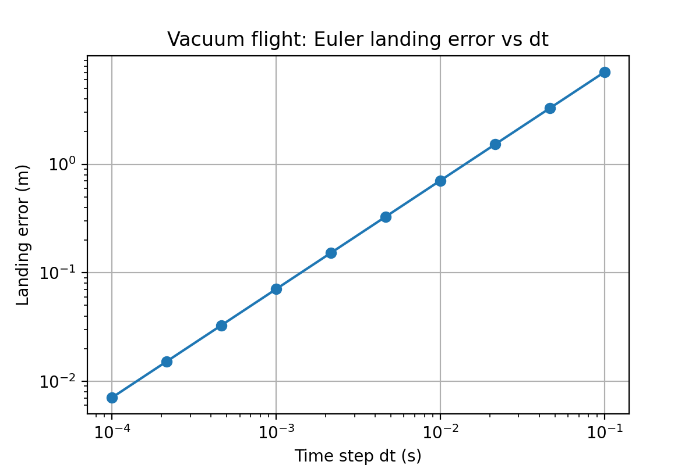

# Missile Mk I
A Python simulator that models the flight of a missile, built as a learning project stage by stage from vacuum point flight mass, to drag, atmosphere and thrust.
Each stage is validated against analytic results and numerical convergence is checked.

## Status
Stage 1 done: shows the flight path of a missile-style projectile, uses Euler integration with an interpolated landing spot to calculate a landing range within 0.069% of the analytic result.

## Results

### Flight path


### Timestep convergence


Error scales linearly with dt (log-log slope ≈ 1.0), as expected for first-order Euler.

## Run it
```
pip install -r requirements.txt
python src/sim.py
```

## Roadmap
1. **(done)** Vacuum point-mass trajectory, validated against analytic range
2. Drag + ISA standard atmosphere, Euler vs RK4 comparison
3. Mach-dependent drag coefficient (transonic rise), range vs launch speed
4. Thrust: boost-then-coast with decreasing mass
5. Stretch: proportional navigation vs moving target, miss distance vs nav constant